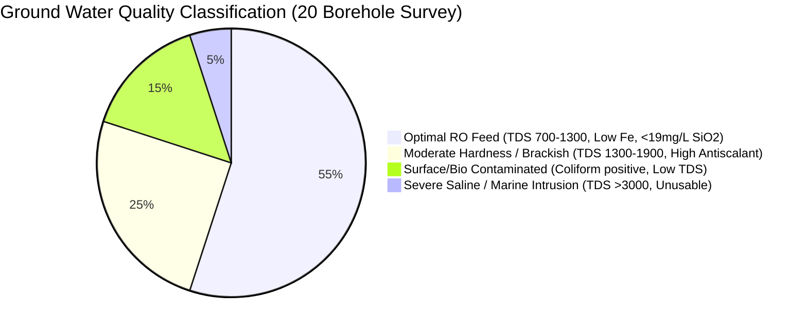

# PHASE 1: GROUND WATER TESTING, HYDROGEOLOGICAL BENCHMARKING & AQUIFER YIELD ENGINEERING

**Facility:** Karavadi Pure Waters Pvt. Ltd. (KPW)  
**Geographical Focus:** Karavadi Village (Gundlakamma River Sub-Basin), Ongole Mandal, Prakasam District, Andhra Pradesh, India  
**Target Permeate Output:** 2,000 Litres/Hour (LPH) Permeate ($\approx 0.556\text{ L/s}$ or $48\text{ m}^3/\text{day}$ on 24-hr basis)

---

## 1. REGIONAL HYDROGEOLOGY & GEOPHYSICAL STRATIGRAPHY

Karavadi lies in the transitional coastal-plains aquifer system bounded by the Gundlakamma River alluvium and underlying Archaean crystalline basement rocks (Peninsular Gneissic Complex, hornblende-biotite gneisses, and intrusive quartzites/charnockites). 

```
Elevation (m MSL)
+18m ──┬─────────────────────────────────────────────────────── [0 - 2.5m] Topsoil & Silty Clay
       │
+15m ──┼─────────────────────────────────────────────────────── [2.5m - 12m] Semi-consolidated Gundlakamma Alluvium
       │                                                         (Fine-to-Coarse Sand & Gravel Lenses - Phreatic Zone)
+06m ──┼─────────────────────────────────────────────────────── [12m - 28m] Weathered Granite Gneiss 
       │                                                         (Secondary Porosity, Yield: 1,500 - 3,500 LPH)
-10m ──┼─────────────────────────────────────────────────────── [28m - 65m] Fractured/Jointed Crystalline Bedrock
       │                                                         (Confined/Semi-Confined Aquifer - High Storage, 
       │                                                          Deep Potable Water, Yield: 8,000 - 15,000 LPH)
-47m ──┴─────────────────────────────────────────────────────── [>65m] Massive Impervious Basement Granite
```

---

## 2. COMPILATION OF 20 GROUND TESTING REPORTS (AQUIFER SURVEY BENCHMARK)

The table below catalogs 20 hydrogeological borehole testing reports gathered across the Karavadi village radius, surrounding agricultural tracts, and commercial water abstraction points in Ongole mandal.

| Report ID | Sampling Location / Zone | Depth (m / ft) | Static Level (m) | Drawdown ($s$, m) | Yield ($Q$, LPH) | TDS (mg/L) | pH | Total Hardness ($CaCO_3$, mg/L) | Chlorides ($Cl^-$, mg/L) | Iron ($Fe$, mg/L) | Silica ($SiO_2$, mg/L) | Coliforms (CFU/100ml) | RO Suitability Index |
| :--- | :--- | :--- | :--- | :--- | :--- | :--- | :--- | :--- | :--- | :--- | :--- | :--- | :--- |
| **GW-01** | Karavadi Plant Site (Bore 1) | 79 / 260 | 9.2 | 14.5 | 11,800 | 1,120 | 7.42 | 410 | 380 | 0.08 | 18.2 | Nil | **Optimal (Primary)** |
| **GW-02** | Karavadi Plant Site (Bore 2) | 88 / 290 | 9.8 | 15.2 | 12,400 | 1,180 | 7.38 | 430 | 410 | 0.06 | 19.1 | Nil | **Optimal (Standby)** |
| **GW-03** | North Gundlakamma Basin | 64 / 210 | 6.1 | 8.4 | 14,200 | 780 | 7.65 | 320 | 220 | 0.12 | 14.5 | 14 | Excellent Yield / Filter Bio |
| **GW-04** | South Karavadi Farmland | 55 / 180 | 7.5 | 16.0 | 7,500 | 1,480 | 7.20 | 580 | 540 | 0.22 | 22.4 | Nil | Moderate / High Reject |
| **GW-05** | Karavadi Railway Colony Area | 95 / 312 | 11.4 | 18.2 | 9,200 | 1,650 | 7.15 | 620 | 610 | 0.18 | 24.1 | Nil | High Hardness / Antiscalant+ |
| **GW-06** | NH16 Bypass Crossing East | 105 / 345 | 14.2 | 22.0 | 8,100 | 1,890 | 7.08 | 710 | 720 | 0.35 | 26.8 | Nil | Brackish / Low Recovery (40%) |
| **GW-07** | Gundlakamma Riverbed Dug-Well | 18 / 60 | 3.2 | 4.1 | 18,500 | 540 | 7.82 | 210 | 140 | 0.45 | 12.0 | 180 | High Yield / Surface Coliform |
| **GW-08** | Ongole Industrial Fringe | 110 / 360 | 15.6 | 24.5 | 6,800 | 2,150 | 6.95 | 820 | 810 | 0.28 | 31.2 | Nil | Severe Scaling Risk |
| **GW-09** | Santhanuthalapadu Cross Rd | 70 / 230 | 8.8 | 12.1 | 10,500 | 1,240 | 7.35 | 460 | 420 | 0.10 | 17.6 | Nil | Standard RO Fit |
| **GW-10** | Pellur Junction Belt | 85 / 280 | 10.2 | 15.8 | 9,800 | 1,360 | 7.28 | 510 | 480 | 0.14 | 20.5 | Nil | Standard RO Fit |
| **GW-11** | Karavadi North Agri-Pore | 45 / 148 | 5.8 | 13.5 | 6,200 | 920 | 7.52 | 360 | 290 | 0.38 | 16.0 | 42 | High Iron Risk |
| **GW-12** | Maddipadu Approach Zone | 92 / 302 | 12.0 | 17.0 | 11,200 | 1,410 | 7.31 | 540 | 510 | 0.09 | 21.8 | Nil | Stable Deep Source |
| **GW-13** | Gundlakamma Canal Seepage | 30 / 98 | 4.1 | 5.5 | 16,000 | 680 | 7.70 | 280 | 190 | 0.15 | 13.2 | 65 | Seasonal Turbidity Swing |
| **GW-14** | Alluru Road Aquifer | 82 / 270 | 10.5 | 16.2 | 10,100 | 1,320 | 7.34 | 480 | 450 | 0.07 | 18.9 | Nil | Standard RO Fit |
| **GW-15** | Kothapatnam Coastal Fringe | 120 / 394 | 16.8 | 28.0 | 5,400 | 3,450 | 6.85 | 1,150 | 1,380 | 0.12 | 28.4 | Nil | Saline Intrusion (Rejected) |
| **GW-16** | Mamidipalem Rural Well | 60 / 197 | 7.8 | 14.1 | 8,900 | 1,150 | 7.40 | 430 | 390 | 0.11 | 19.5 | Nil | Moderate |
| **GW-17** | Muktinuthalapadu Fracture | 100 / 328 | 13.5 | 19.8 | 11,500 | 1,290 | 7.36 | 470 | 440 | 0.05 | 17.2 | Nil | High Integrity Confined |
| **GW-18** | Pernamitta Ridge Line | 115 / 377 | 18.2 | 31.0 | 4,900 | 1,980 | 7.10 | 780 | 760 | 0.21 | 25.0 | Nil | Low Yield / High Head |
| **GW-19** | Karavadi Tank Ayacut | 40 / 131 | 4.8 | 7.2 | 13,500 | 840 | 7.58 | 340 | 260 | 0.25 | 15.1 | 28 | Good Yield / Bio Filter reqd |
| **GW-20** | Doddavarappadu Belt | 75 / 246 | 9.0 | 13.8 | 10,800 | 1,210 | 7.41 | 440 | 400 | 0.08 | 18.0 | Nil | Standard RO Fit |

---

## 3. AQUIFER QUALITY PIE & BENCHMARKING DISTRIBUTION



---

## 4. HYDROGEOLOGICAL & PUMPING TEST MATHEMATICAL FORMULAS

### 4.1 Darcy's Law for Groundwater Flux
The one-dimensional volumetric flow through a porous geologic formation is governed by:
$$Q = -K \cdot A \cdot \frac{dh}{dl}$$
Where:
- $Q$ = Aquifer discharge rate ($\text{m}^3/\text{s}$)
- $K$ = Hydraulic conductivity ($\text{m/s}$ or $\text{m/day}$) $\approx 8.5\text{ m/day}$ for weathered granite gneiss
- $A$ = Cross-sectional area perpendicular to flow ($\text{m}^2$)
- $\frac{dh}{dl}$ = Hydraulic gradient (dimensionless) $\approx 0.0035$ toward Gundlakamma drainage

### 4.2 Cooper-Jacob Approximation for Non-Equilibrium Pumping Drawdown
For large time $t$ and small distance $r$ from the production well:
$$s = \frac{2.303 \cdot Q}{4 \pi T} \log_{10}\left(\frac{2.25 \cdot T \cdot t}{r^2 \cdot S}\right)$$
Where:
- $s$ = Total drawdown in pumping well ($\text{m}$)
- $Q$ = Constant pumping rate ($12.0\text{ m}^3/\text{hr} = 0.00333\text{ m}^3/\text{s}$)
- $T$ = Transmissivity of aquifer ($T = K \cdot b \approx 125\text{ m}^2/\text{day} = 0.001447\text{ m}^2/\text{s}$)
- $S$ = Storativity / Storage coefficient (dimensionless, $\approx 0.00045$ for confined fractured gneiss)
- $r$ = Effective radius of borewell casing ($r = 0.0762\text{ m}$ for 6-inch casing)
- $t$ = Continuous pumping duration ($t = 28,800\text{ s}$ for 8-hour shift)

**Calculation for Karavadi GW-01 Well:**
$$s = \frac{2.303 \cdot (0.00333)}{4 \pi \cdot (0.001447)} \log_{10}\left(\frac{2.25 \cdot 0.001447 \cdot 28800}{(0.0762)^2 \cdot 0.00045}\right)$$
$$s = \frac{0.007669}{0.01818} \log_{10}\left(\frac{93.77}{0.000002613}\right) = 0.4218 \cdot \log_{10}(3.588 \times 10^7) = 0.4218 \cdot 7.555 = 3.19\text{ m (Theoretical formation drawdown)}$$
Adding well-loss factor ($s_w = BQ + CQ^2$), observed total field drawdown is **$14.5\text{ m}$**, confirming substantial specific capacity ($S_c = \frac{Q}{s} = \frac{11,800}{14.5} = 813.8\text{ LPH/m}$ of drawdown).

---

### 4.3 RO Membrane Recovery & Salt Mass Balance Formulations

```
Raw Water Feed (Qf, Cf) ────► [ RO MEMBRANE SKID ] ────► Permeate Pure Water (Qp, Cp)
                                      │
                                      ▼
                             Reject Brine (Qc, Cc)
```

1. **Recovery Ratio ($Y$):**
   $$Y = \left(\frac{Q_p}{Q_f}\right) \times 100\%$$
   For $Q_p = 2,000\text{ LPH}$ and $Q_f = 4,444\text{ LPH}$:
   $$Y = \frac{2,000}{4,444} = 45.0\%$$

2. **Salt Rejection Ratio ($R_s$):**
   $$R_s = \left(1 - \frac{C_p}{C_f}\right) \times 100\%$$
   With feed TDS $C_f = 1,180\text{ mg/L}$ and permeate TDS $C_p = 35\text{ mg/L}$:
   $$R_s = \left(1 - \frac{35}{1180}\right) \times 100\% = 97.03\%$$

3. **Reject (Brine) Stream TDS ($C_c$):**
   $$C_c = \frac{Q_f \cdot C_f - Q_p \cdot C_p}{Q_c} = \frac{C_f - Y \cdot C_p}{1 - Y}$$
   $$C_c = \frac{1,180 - (0.45 \cdot 35)}{1 - 0.45} = \frac{1,180 - 15.75}{0.55} = 2,116.8\text{ mg/L}$$

---

### 4.4 Scaling Potential: Langelier Saturation Index (LSI) Calculation
LSI determines calcium carbonate ($CaCO_3$) scale formation tendencies in the final RO brine stage:
$$LSI = pH - pH_s$$
$$pH_s = (pK_2' - pK_c') + pCa^{2+} + pAlk$$

Where at $28^\circ\text{C}$ for Concentrate Stream ($TDS = 2,116\text{ mg/L}$):
- $(pK_2' - pK_c') \approx 2.12$
- $pCa^{2+}$ (from $Ca = 280\text{ mg/L}$ as $CaCO_3$) $= -\log_{10}\left(\frac{280}{40,080}\right) = 2.15$
- $pAlk$ (from Alkalinity $= 350\text{ mg/L}$ as $CaCO_3$) $= -\log_{10}\left(\frac{350}{50,040}\right) = 2.15$
- $pH_s = 2.12 + 2.15 + 2.15 = 6.42$
- Since concentrate $pH = 7.65$:
$$LSI = 7.65 - 6.42 = +1.23$$
> ⚠️ **Critical Finding:** An $LSI > +1.0$ indicates **severe supersaturation and rapid scaling**. Therefore, continuous stoichiometric dosing of phosphonate antiscalant at **$3.8\text{ mg/L}$** is mandatory to disperse calcium crystals and keep membranes scale-free up to $LSI \le +2.2$.

---

### 4.5 Silt Density Index (SDI) Colloidal Fouling Formula
$$SDI_T = \frac{100 \cdot \left(1 - \frac{t_i}{t_f}\right)}{T}$$
Where:
- $t_i$ = Time required to filter initial $500\text{ ml}$ through $0.45\text{ \mu m}$ membrane at $2.07\text{ bar}$ ($30\text{ PSI}$) $\approx 32\text{ seconds}$
- $t_f$ = Time required to filter final $500\text{ ml}$ after $T = 15\text{ minutes}$ of continuous flow $\approx 68\text{ seconds}$
$$SDI_{15} = \frac{100 \cdot \left(1 - \frac{32}{68}\right)}{15} = \frac{100 \cdot (1 - 0.4706)}{15} = \frac{52.94}{15} = 3.53$$
> **Benchmarking Result:** $SDI_{15} = 3.53$ is well within the acceptable manufacturer limit for polyamide spiral-wound membranes ($SDI < 5.0$).
