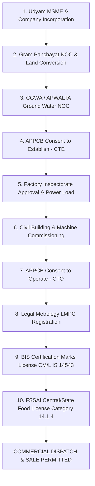

# PHASE 4: BIS IS 14543:2016 & FSSAI STATUTORY LICENSING & REGULATORY MANUAL

**Regulatory Mandate:** Prevention of Food Adulteration / FSS Act 2006 (Section 31) & Bureau of Indian Standards Act 2016  
**Product Specification:** IS 14543:2016 (*Packaged Drinking Water Other Than Packaged Natural Mineral Water*)  
**Competent Jurisdictions:** BIS Southern Regional Office (Vijayawada Branch), FSSAI Southern Region (Chennai/AP), APPCB (Ongole Regional Office)

---

## 1. MASTER REGULATORY ROADMAP: 10 MANDATORY STATUTORY APPROVALS



### Statutory Regulatory Approval Matrix:
| Seq | License / Clearance Authority | Purpose & Regulatory Scope | Validity / Renewal | Government Fee (Approx) | Processing Timeline |
| :--- | :--- | :--- | :--- | :--- | :--- |
| **01** | Ministry of Corporate Affairs / MSME | Incorporation (Pvt Ltd/LLP) & Udyam Certificate | Permanent | ₹2,000 – ₹8,000 | 5 – 7 Days |
| **02** | Karavadi Gram Panchayat / RDO | Commercial building permission & trade NOC | 1 Year / Annual | ₹5,000 – ₹10,000 | 15 – 20 Days |
| **03** | Central Ground Water Authority (CGWA) | Commercial abstraction of $48\text{ m}^3/\text{day}$ raw water | 3 Years | ₹10,000 + Water Cess | 45 – 60 Days |
| **04** | AP Pollution Control Board (APPCB) | **Consent to Establish (CTE)** - Environmental clearance | Pre-construction | ₹15,000 – ₹25,000 | 21 – 30 Days |
| **05** | APPCB Regional Office Ongole | **Consent to Operate (CTO)** - Water & Air Pollution | 5 Years | ₹20,000 – ₹35,000 | 30 Days |
| **06** | Directorate of Factories, AP | Factory license & mechanical machinery safety approval | 1 – 3 Years | ₹8,000 – ₹12,000 | 20 Days |
| **07** | Dept of Legal Metrology (Weights & Measures) | LMPC certificate for pre-packaged commodities | 5 Years | ₹5,000 | 15 Days |
| **08** | **Bureau of Indian Standards (BIS)** | **CM/L License to use ISI Mark** under IS 14543:2016 | 1 – 2 Years | ₹1,000 App + ₹45,000 Audit + Marking fee | 45 – 75 Days |
| **09** | **Food Safety & Standards Authority (FSSAI)** | **State/Central License** (Kind of Business: 14.1.4) | 1 – 5 Years | ₹7,500 / year | 15 – 30 Days |
| **10** | Controller General of Patents, Designs & TM | Trademark registration for Brand Name & Logo | 10 Years | ₹4,500 (MSME fee) | 3 Days for filing |

---

## 2. BIS IS 14543:2016 STEP-BY-STEP CERTIFICATION WORKFLOW

```
1. Portal Registration (manakonline.in) -> Create Company Profile & Upload Documents
   │
2. Application Submission (Form V) + Upload Scheme of Testing & Inspection (STI)
   │
3. In-House Lab Readiness Audit (Self-inspection of all 42 required lab testing apparatus)
   │
4. Chemist & Microbiologist Document Verification (Degree certificates & competency test)
   │
5. Physical Plant Inspection by BIS Officers (Verification of Class 100 cleanroom, airlocks)
   │
6. In-Plant Trial Run & Performance Testing (On-site demonstration of chemical/micro tests)
   │
7. Sealing of Official Factory Samples (20L Cans + 1L PET Bottles drawn by BIS Officer)
   │
8. Testing at Independent NABL / BIS Laboratory (Independent test across all 52 parameters)
   │
9. Verification of Independent Test Report (Pass status across chemical, pesticide & micro tests)
   │
10. Grant of CM/L (Certification Marks License) & Allotment of Official 7-Digit License Number
```

---

## 3. MASTER PARAMETERS & LIMITS UNDER BIS IS 14543:2016

Every batch must comply with the physical, chemical, and microbiological thresholds listed below:

### 3.1 Physical & General Organoleptic Limits
- **Colour:** Max 2 Hazen Units
- **Odour & Taste:** Agreeable / Natural taste (No off-odours or plastic leach)
- **Turbidity:** Max **$2\text{ NTU}$** (Internal plant quality target: $<0.2\text{ NTU}$)
- **pH:** **$6.5\text{ to }8.5$**
- **Total Dissolved Solids (TDS):** **$75\text{ to }500\text{ mg/L}$**

### 3.2 Toxic & Inorganic Contaminants (mg/L max)
| Parameter | Permissible Limit (IS 14543) | Parameter | Permissible Limit (IS 14543) |
| :--- | :--- | :--- | :--- |
| **Calcium ($Ca$)** | Max $75\text{ mg/L}$ | **Fluoride ($F$)** | Max $1.0\text{ mg/L}$ |
| **Magnesium ($Mg$)** | Max $30\text{ mg/L}$ | **Nitrate ($NO_3$)** | Max $45\text{ mg/L}$ |
| **Chloride ($Cl^-$)** | Max $200\text{ mg/L}$ | **Iron ($Fe$)** | Max $0.1\text{ mg/L}$ |
| **Sulphate ($SO_4$)** | Max $200\text{ mg/L}$ | **Arsenic ($As$)** | Max $0.01\text{ mg/L}$ |
| **Lead ($Pb$)** | Max $0.01\text{ mg/L}$ | **Mercury ($Hg$)** | Max $0.001\text{ mg/L}$ |
| **Cadmium ($Cd$)** | Max $0.003\text{ mg/L}$ | **Chromium ($Cr$)** | Max $0.05\text{ mg/L}$ |

### 3.3 Pesticide Residue Limits (Sub-ppb analysis by GC-MS/MS)
- **Individual Pesticides:** Max **$0.0001\text{ mg/L}$** ($0.1\text{ ppb}$)
- **Total Pesticides Combined:** Max **$0.0005\text{ mg/L}$** ($0.5\text{ ppb}$)

### 3.4 Microbiological Pathogen Limits (Non-Negotiable)
| Micro-Organism | Tested Volume | Permissible Limit |
| :--- | :--- | :--- |
| **Total Viable Colony Count ($20 - 22^\circ\text{C}$ for 72 hrs)** | $1\text{ ml}$ | Max $100\text{ CFU/ml}$ |
| **Total Viable Colony Count ($37^\circ\text{C}$ for 24 hrs)** | $1\text{ ml}$ | Max $20\text{ CFU/ml}$ |
| **Coliform Bacteria** | $250\text{ ml}$ | **MUST BE ABSENT (0 CFU)** |
| **Escherichia coli** | $250\text{ ml}$ | **MUST BE ABSENT (0 CFU)** |
| **Faecal Streptococci** | $250\text{ ml}$ | **MUST BE ABSENT (0 CFU)** |
| **Staphylococcus aureus** | $100\text{ ml}$ | **MUST BE ABSENT (0 CFU)** |
| **Pseudomonas aeruginosa** | $250\text{ ml}$ | **MUST BE ABSENT (0 CFU)** |
| **Sulphite-reducing Anaerobes (*Clostridia*)** | $50\text{ ml}$ | **MUST BE ABSENT (0 CFU)** |
| **Yeast and Moulds** | $250\text{ ml}$ | **MUST BE ABSENT (0 CFU)** |
| **Salmonella & Shigella** | $250\text{ ml}$ | **MUST BE ABSENT (0 CFU)** |

---

## 4. STATUTORY DOCUMENT TEMPLATE: SCHEME OF TESTING & INSPECTION (STI)

```
================================================================================
                    ANNEXURE TO BIS LICENSE CM/L-XXXXXXXXX
          SCHEME OF TESTING AND INSPECTION (STI) FOR PACKAGED DRINKING WATER
                    CONFORMING TO IS 14543:2016
================================================================================
1. LABORATORY RECORDS:
   All testing shall be carried out in the licensee's own certified laboratory 
   by BIS-approved technical personnel. Full test records shall be maintained 
   in bound registers and digital logbooks for a minimum retention period of 
   2 years from the date of manufacture.

2. ROUTINE TESTING FREQUENCY:
   Clause A: Hourly Testing
   - pH (IS 3025 Pt 11)                    : Every 1 hour of continuous run
   - Total Dissolved Solids (TDS)          : Every 1 hour of continuous run
   - Turbidity                             : Every 2 hours of continuous run
   - Residual Ozone Concentration          : Every 1 hour at filling point

   Clause B: Daily Batch Testing
   - Odour, Colour, Taste                  : 1 sample per batch
   - Total Hardness (as CaCO3)             : 1 sample per batch
   - Chlorides & Sulphates                 : 1 sample per batch
   - Total Coliform Bacteria (Membrane)    : 1 sample per batch / filling nozzle

   Clause C: Weekly Testing
   - Aerobic Microbial Count (22°C & 37°C) : 1 sample per week
   - Faecal Streptococci                   : 1 sample per week
   - Pseudomonas aeruginosa                : 1 sample per week

3. MARKING AND PACKAGING REQUIREMENTS:
   Every container (20L Can, 1L PET Bottle) shall clearly display:
   a) Standard ISI Mark with License Number "CM/L-XXXXXXXXX"
   b) FSSAI License Number "101XXXXXXXXXXXXXXXXX"
   c) Name and physical address of manufacturing unit:
      "Karavadi Pure Waters Pvt. Ltd., Karavadi, Ongole Mandal, Prakasam Dt, AP"
   d) Date of Packaging & Batch / Lot Number
   e) Best Before date ("Best before 6 months from packaging")
   f) Storage instructions ("Store in clean, dry, hygienic place away from sunlight")
================================================================================
```
