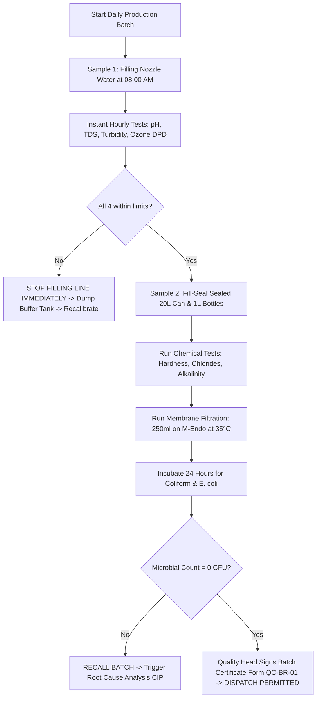

# PHASE 5: IN-HOUSE LABORATORY QUALITY CONTROL - 20 STANDARD OPERATING PROCEDURES (SOPS)

**Mandatory Requirement:** BIS IS 14543:2016 Clause 7 & Scheme of Testing and Inspection (STI)  
**Laboratory Facility:** Karavadi Pure Waters Pvt. Ltd. Central Quality Control & Microbiology Lab  
**Testing Scope:** Physical, Chemical, Organoleptic & Microbiological Batch Release

---

## 1. COMPENDIUM OF 20 LABORATORY STANDARD OPERATING PROCEDURES

| SOP Code | Test Description / Target Parameter | Test Method / Standard Reference | Required Instruments / Reagents | Batch Frequency | Pass / Action Limits |
| :--- | :--- | :--- | :--- | :--- | :--- |
| **SOP-QC-01** | Lab Biosafety & Autoclave Disposal | WHO Biosafety / BIS Guidelines | Steam Autoclave, $1\% \text{ Virkon}$, Hypo | Daily continuous | Zero live pathogen release |
| **SOP-QC-02** | Culture Media Preparation & Sterility Check | IS 5402 / ISO 11133 | M-Endo, PCA, Cetrimide, Dehydrated media | Every media batch | Negative control must show 0 growth |
| **SOP-QC-03** | **Detection of Coliforms & E. coli** | **IS 15185 / Membrane Filter** | Vacuum Manifold, $0.45\text{\mu m}$ gridded filters, M-Endo | **Every Batch (250 ml)** | **0 CFU / 250 ml (Must be ABSENT)** |
| **SOP-QC-04** | Detection of *Pseudomonas aeruginosa* | IS 13428 Annex D | Cetrimide Agar, Acetamide Broth, UV $365\text{nm}$ | Weekly / When alerted | **0 CFU / 250 ml (Must be ABSENT)** |
| **SOP-QC-05** | Total Viable Count (Aerobic Plate Count) | IS 5402 (Pour Plate Method) | Plate Count Agar (PCA), Incubator ($22^\circ\text{C}$ & $37^\circ\text{C}$) | Every Batch | Max $20\text{ CFU/ml}$ ($37^\circ\text{C}$), $100\text{ CFU/ml}$ ($22^\circ\text{C}$) |
| **SOP-QC-06** | Detection of Faecal Streptococci | IS 15186 / Membrane Filter | KF-Streptococcus Agar, TTC dye | Weekly | **0 CFU / 250 ml (Must be ABSENT)** |
| **SOP-QC-07** | Detection of *Clostridia* (Anaerobes) | IS 13428 Annex C | Differential Reinforced Clostridial Medium (DRCM) | Monthly | **0 CFU / 50 ml (Must be ABSENT)** |
| **SOP-QC-08** | **pH Determination & Buffer Calibration** | **IS 3025 (Part 11)** | Digital pH meter, Glass electrode, Buffers 4.0, 7.0, 9.2 | **Hourly** | **6.50 – 8.50** |
| **SOP-QC-09** | **TDS & Electrical Conductivity** | **IS 3025 (Part 14/16)** | Microprocessor Conductivity Meter, $1413\text{\mu S/cm}$ KCl | **Hourly** | **75 – 500 mg/L (Target: 110–130)** |
| **SOP-QC-10** | **Turbidity (Nephelometric)** | **IS 3025 (Part 10)** | Digital Nephelo-Turbidity Meter, Formazin standards | **Every 2 Hours** | **Max 2.0 NTU (Target: <0.15 NTU)** |
| **SOP-QC-11** | Total Hardness & Calcium/Magnesium | IS 3025 (Part 21) | $0.01\text{M EDTA}$, Eriochrome Black T, Murexide | Daily per Batch | Max $200\text{ mg/L as } CaCO_3$ |
| **SOP-QC-12** | Chlorides by Argentometric Titration | IS 3025 (Part 32) | $0.0141\text{N AgNO}_3$, Potassium Chromate ($K_2CrO_4$) | Daily per Batch | Max $200\text{ mg/L}$ |
| **SOP-QC-13** | Total Alkalinity (Phenol & Methyl Orange) | IS 3025 (Part 23) | $0.02\text{N } H_2SO_4$, Phenolphthalein, Methyl Orange | Daily per Batch | Max $200\text{ mg/L as } CaCO_3$ |
| **SOP-QC-14** | **Residual Ozone Concentration** | **IS 3025 (Part 47) / DPD** | Hach/Lovibond Ozone Photometer, DPD-4 reagent | **Hourly at Filling Head**| **0.20 – 0.40 mg/L** |
| **SOP-QC-15** | Free & Total Chlorine Residual | IS 3025 (Part 26) / DPD-1 | Pocket Colorimeter, DPD Free Chlorine reagent | Raw sump (Hourly) | Raw: $0.5 - 1.5\text{ ppm}$; Permeate: $0.0\text{ ppm}$ |
| **SOP-QC-16** | Sulphate by Barium Turbidimetry | IS 3025 (Part 24) | Spectrophotometer ($420\text{ nm}$), $BaCl_2$ crystals | Weekly | Max $200\text{ mg/L}$ |
| **SOP-QC-17** | Nitrate & Fluoride Spectrophotometry | IS 3025 (Part 34 & 60) | UV-Vis Double Beam Spectrophotometer | Weekly | Nitrate $<45\text{ mg/L}$; Fluoride $<1.0\text{ mg/L}$ |
| **SOP-QC-18** | Cleanroom Air Settle Plate Count | IS 14543 Annex E | Settle plates (SDA & PCA), 4-hour exposure | Twice Weekly | $<15\text{ CFU/plate}$ in filling cleanroom |
| **SOP-QC-19** | Surface & Hand Swab Hygiene Audit | US Pharmacopeia <1116> | Sterile swabs, Neutralizing buffer, Plate Count Agar | Weekly | Filling nozzle: $0\text{ CFU}$; Operator hand: $<5\text{ CFU}$ |
| **SOP-QC-20** | **Organoleptic & Batch Release Review** | **IS 14543 Clause 5** | Human sensory panel ($25^\circ\text{C}$), Cleanroom air lock | **Every Batch** | **Neutral clean taste; Approved signoff** |

---

## 2. LABORATORY TESTING FORMULAS & TITRIMETRIC EQUATIONS

### 2.1 Total Hardness Titration Formula (SOP-QC-11)
$$\text{Total Hardness (as } CaCO_3\text{, mg/L)} = \frac{V_{EDTA} \times M \times 100,090}{V_{sample}}$$
Where:
- $V_{EDTA}$ = Volume of standardized $EDTA$ titrant consumed ($\text{ml}$)
- $M$ = Molarity of $EDTA$ solution ($0.0100\text{ M}$)
- $V_{sample}$ = Volume of water sample taken for titration ($50.0\text{ ml}$)
- $100,090$ = Molecular mass equivalent of $CaCO_3$ ($\text{mg/mol}$)

*Example:* If $V_{EDTA} = 5.2\text{ ml}$:
$$\text{Total Hardness} = \frac{5.2 \times 0.0100 \times 100,090}{50} = \mathbf{104.09\text{ mg/L as } CaCO_3\text{ (Conforms to IS 14543)}}$$

---

### 2.2 Chloride Argentometric Titration Formula (SOP-QC-12)
$$\text{Chloride (} Cl^-\text{, mg/L)} = \frac{(V_{sample\_titrant} - V_{blank}) \times N \times 35,450}{V_{sample}}$$
Where:
- $V_{sample\_titrant}$ = Volume of $0.0141\text{ N } AgNO_3$ consumed ($\text{ml}$)
- $V_{blank}$ = Reagent blank titration volume ($\approx 0.2\text{ ml}$)
- $N$ = Normality of Silver Nitrate ($0.0141\text{ N}$)
- $35,450$ = Atomic weight of Chlorine ($\text{mg/mol}$)
- $V_{sample} = 50.0\text{ ml}$

---

### 2.3 Residual Ozone Photometric Derivation (SOP-QC-14)
Using the DPD colorimetric oxidation method measured at $\lambda = 530\text{ nm}$:
$$O_3 + 2 I^- + 2 H^+ \longrightarrow I_2 + O_2 + H_2O$$
$$I_2 + \text{DPD (colourless)} \longrightarrow \text{Würster Dye (Magenta pink)}$$
$$\text{Residual Ozone (mg/L)} = \frac{A_{530} - \text{Intercept}}{\text{Slope}} \times \text{Dilution Factor}$$
If optical absorbance $A_{530} = 0.285$, calibration curve yields **$0.31\text{ mg/L}$**, which is perfectly in the BIS sweet zone ($0.20 - 0.40\text{ mg/L}$).

---

### 2.4 Microbiological Membrane Filtration Formula (SOP-QC-03)
$$\text{Coliform Density (CFU / 250 ml)} = \frac{\text{Colonies Counted on M-Endo Grid}}{\text{Volume of Sample Filtered (ml)}} \times 250\text{ ml}$$
On M-Endo agar at $35.0^\circ\text{C} \pm 0.5^\circ\text{C}$ for $24\text{ hours}$, coliforms produce distinct **golden-green metallic sheen** colonies.  
**Requirement for Batch Clearance:** Count must be **$0\text{ colonies}$**. If even $1\text{ colony}$ appears, the entire batch is quarantined and rejected.

---

## 3. DAILY LABORATORY QUALITY CONTROL BATCH RELEASE WORKFLOW

