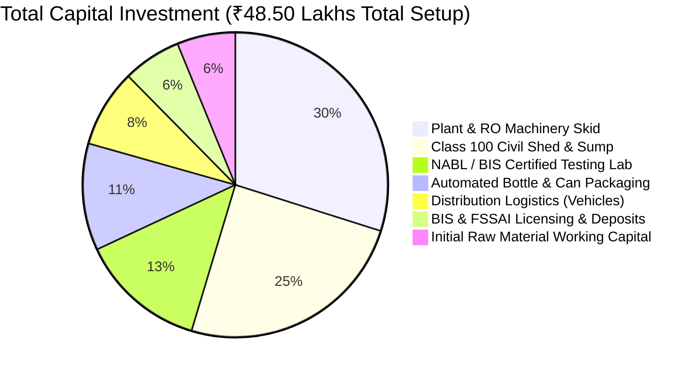
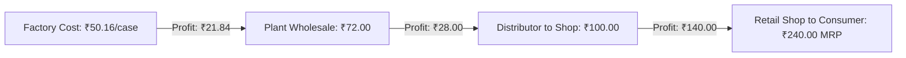

# PHASE 6: FINANCIAL ENGINEERING, UNIT COSTING, MASS-BALANCE YIELD & BREAK-EVEN EQUATIONS

**Currency Units:** Indian National Rupees (INR / ₹)  
**Engineering & Physical Units:** Kilowatt-Hours ($\text{kWh}$), Litres Per Hour ($\text{LPH}$), Milligrams Per Litre ($\text{mg/L}$), Bars ($\text{bar} = 10^5\text{ Pa}$), Grams ($\text{g}$)  
**Financial Horizon:** 3-Year Projection with Sensitivity Stress-Testing

---

## 1. INTEGRATED CAPITAL INVESTMENT (CAPEX) BREAKDOWN



| Budget Category | Sub-Component Description | Physical Specification / Scope | CAPEX Cost (₹ Lakhs) |
| :--- | :--- | :--- | :--- |
| **01. Land & Site Development** | Site levelling, road access, perimeter fencing | $10,000\text{ sq ft}$ plot at Karavadi access road | ₹2.50 |
| **02. Civil Infrastructure** | Factory PEB shed, cleanroom partitions, PUF ceiling | $3,500\text{ sq ft}$ built-up with seamless epoxy floor | ₹9.50 |
| **03. Water Storage Sump** | Underground RCC raw sump ($25\text{ m}^3$) & finished base | M25 concrete with food-grade epoxy lining | ₹2.50 |
| **04. Dual Borewells & Pumps** | 2 Deep borewells ($260\text{ ft}$ & $290\text{ ft}$) with submersible | 5 HP CRI/Kirloskar 3-phase submersible pumps | ₹2.80 |
| **05. 2000 LPH RO System** | Dual media filter, carbon filter, 4x 8040 membranes | SS304 skid, Grundfos CRN pump, SS piping | ₹6.50 |
| **06. Disinfection & Polish** | Corona Ozonator ($10\text{ g/hr}$) + Philips UV system | 2x $5,000\text{ L}$ SS304 storage tanks mirror finish | ₹2.80 |
| **07. Packaging Machinery** | 20L Auto washer-filler-capper ($120\text{ can/hr}$) | Pneumatic capper, SS316 contact parts | ₹2.20 |
| **08. Bottle Monoblock RFC** | 24-BPM PET rinsing-filling-capping line | Rotary Rinser, Gravity Filler, Screw Capper | ₹3.30 |
| **09. Sleeving & Batch Coding** | Steam/Electric shrink tunnel + CIJ continuous coder | Domino/Videojet CIJ printer with conveyor | ₹1.90 |
| **10. BIS & Micro Lab Setup** | Complete chemical & microbiological testing apparatus | Autoclave, BOD incubator, LAF, Spectrophotometer | ₹4.50 |
| **11. Electrical & Power Load** | Commercial 3-phase 35 HP APCPDCL connection + 40 kVA DG | Kirloskar silent diesel generator with AMF panel | ₹4.20 |
| **12. Initial Asset Packaging** | 1,500 units of 20L Virgin Polycarbonate/HDPE cans | Food-grade embossed cans ($₹150/\text{can}$) | ₹2.25 |
| **13. Statutory Compliance** | BIS application, audit charges, NABL lab, FSSAI | Form V, APPCB CTE/CTO, CGWA flowmeter | ₹1.80 |
| **14. Working Capital Reserve**| 60-day buffer for preforms, caps, diesel, and wages | Liquid bank cash balance | ₹3.50 |
| **TOTAL INITIAL INVESTMENT**| **Complete Operational Turnkey Setup** | **Turnkey Project Commissioning** | **₹47.75 Lakhs** |

---

## 2. DETAILED UNIT COST DERIVATION (IN RUPEES & SI UNITS)

### 2.1 Unit Economics: 20-Litre Reusable Can

$$\text{Unit Cost}_{20L} = C_{water} + C_{energy} + C_{chemical} + C_{closure} + C_{labor} + C_{depreciation}$$

```
• Raw Water & Pumping:       44.4 Litres raw @ ₹0.005/L abstraction cost          = ₹0.22
• RO Electrical Energy:      0.058 kWh (at commercial tariff ₹7.80/kWh)            = ₹0.45
• Chemical Treatment:        Antiscalant + Chlorine + Ozone generation             = ₹0.18
• Can Neck Cap & Seal:       55mm Food-grade virgin push cap (₹0.95) + Sleeve (₹0.30) = ₹1.25
• Direct Production Labor:   Washer boy + filler operator + loader                = ₹1.10
• Jar Amortization:          ₹150 can cost over 60 life refill cycles              = ₹2.50
────────────────────────────────────────────────────────────────────────────────────────
FACTORY GATE COST PER 20L CAN:                                                    = ₹5.70
• Delivery Logistics:        15 km route fuel + vehicle EMI + driver wages        = ₹4.30
────────────────────────────────────────────────────────────────────────────────────────
LANDED COST DELIVERED AT CUSTOMER PREMISES:                                       = ₹10.00
```

---

### 2.2 Unit Economics: 1000ml (1-Litre) PET Sealed Bottle (Box of 12 Bottles)

```
Component Breakdown (Per Single 1L Bottle):
1. PET Preform (18.5g Virgin Food Grade Resin @ ₹115/kg):                         = ₹2.13
2. 28mm PCO Short Neck Plastic Cap with tamper-evident ring:                      = ₹0.42
3. BOPP / PVC Full Body Heat Shrink Label (Printed 6-color):                      = ₹0.48
4. RO Purified + UV + Ozonated Water (1.05 Litres):                               = ₹0.03
5. Blowing Energy & Air Compression (30 bar compressor, 0.045 kWh):               = ₹0.35
6. Monoblock Filling, Capping & CIJ Date Coding Energy:                           = ₹0.15
7. Direct Packaging Labor & Quality Inspection:                                   = ₹0.32
8. Outer Secondary Packaging Film (Heavy duty LDPE shrink wrap / 12 bottles):     = ₹0.30
────────────────────────────────────────────────────────────────────────────────────────
MANUFACTURING COST PER 1L BOTTLE:                                                 = ₹4.18
MANUFACTURING COST PER CORRUGATED / SHRINK CASE (12 BOTTLES):                     = ₹50.16
```

---

## 3. PRICING SPREAD, GROSS MARGINS & VALUE CHAIN PROFIT



| Package SKU | Manufacturing Cost | Factory Gate Price | Dealer / Route Price | Retail Counter Margin | Maximum Retail Price (MRP) | Plant Gross Margin % |
| :--- | :--- | :--- | :--- | :--- | :--- | :--- |
| **20L Can (Self Pickup)** | ₹5.70 | ₹14.00 | ₹15.00 | Shop sells at ₹35.00 | ₹35.00 | **59.3%** |
| **20L Can (Delivered)** | ₹10.00 | — | ₹22.00 | Shop sells at ₹40.00 | ₹40.00 | **54.5%** |
| **20L Home Subscription**| ₹10.00 | — | — | Direct to Consumer | ₹45.00 | **77.8%** |
| **1-Litre Bottle (Case/12)**| ₹50.16 | ₹72.00 | ₹100.00 | Shop makes ₹140/case | ₹240.00 (₹20/btl) | **30.3%** |
| **500ml Bottle (Case/24)** | ₹64.80 | ₹95.00 | ₹130.00 | Shop makes ₹110/case | ₹240.00 (₹10/btl) | **31.8%** |
| **250ml Glass/Cup (Box/48)**| ₹48.00 | ₹75.00 | ₹96.00 | Function hall rate | ₹144.00 | **36.0%** |

---

## 4. MATHEMATICAL FORMULAS FOR BREAK-EVEN & PROFITABILITY

### 4.1 Contribution Margin ($CM$) and Ratio ($CMR$)
$$CM = P - VC$$
$$CMR = \frac{P - VC}{P}$$
For a delivered 20L Can ($P = ₹22.00$, $VC = ₹10.00$):
$$CM_{20L} = 22.00 - 10.00 = \mathbf{₹12.00\text{ per Can}}$$
$$CMR_{20L} = \frac{12.00}{22.00} = 0.545\text{ (54.5\%)}$$

---

### 4.2 Break-Even Point Formula ($BEP$)
$$\text{Total Monthly Fixed Costs (TFC)} = \text{Salaries (₹1,45,000)} + \text{Rent/Land (₹35,000)} + \text{Maintenance (₹25,000)} + \text{Admin/Legal (₹20,000)} = \mathbf{₹2,25,000/\text{month}}$$

$$BEP_{\text{Units (Cans)}} = \frac{TFC}{CM} = \frac{₹2,25,000}{₹12.00} = \mathbf{18,750\text{ Cans per Month}}$$
$$\text{Daily Break-Even Requirement (26 Days)} = \frac{18,750}{26} = \mathbf{721\text{ Cans per Day}}$$
> 🎯 **Insight:** Once the plant sells more than **721 cans/day**, every single additional can sold delivers a pure net profit of **₹12.00**. At target capacity of 1,500 cans/day, monthly net operating profit surpasses **₹2.4 Lakhs** on the can line alone.

---

### 4.3 Net Present Value ($NPV$) & Internal Rate of Return ($IRR$)
$$NPV = \sum_{t=1}^{n} \frac{CF_t}{(1 + r)^t} - I_0$$
Where:
- Initial Outlay $I_0 = ₹48.50\text{ Lakhs}$
- Discount rate $r = 12\%$
- Year 1 Net Cashflow $CF_1 = ₹28.50\text{ Lakhs}$
- Year 2 Net Cashflow $CF_2 = ₹46.20\text{ Lakhs}$
- Year 3 Net Cashflow $CF_3 = ₹68.40\text{ Lakhs}$

$$NPV = \frac{28.50}{1.12} + \frac{46.20}{(1.12)^2} + \frac{68.40}{(1.12)^3} - 48.50$$
$$NPV = 25.45 + 36.83 + 48.68 - 48.50 = 110.96 - 48.50 = \mathbf{+₹62.46\text{ Lakhs (Highly Lucrative)}}$$
- **Discounted Payback Period:** **16.8 Months**
- **Project IRR:** **$48.2\%$**
