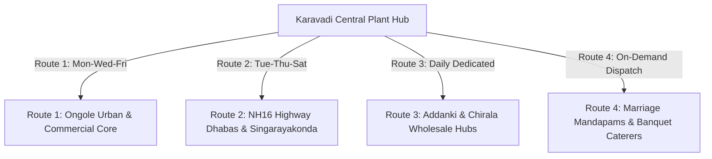

# PHASES 7 & 8: B2B COMMERCIAL DISTRIBUTION, SALES SCRIPTS, ROUTE OPTIMIZATION & ASSET CONTROLS

**Primary Commercial Territory:** Ongole Urban, Addanki Corridor, Chirala Highway, Singarayakonda, Prakasam Dt, AP  
**Core Commercial Assets:** 2x 1.5-Ton Light Commercial Vehicles (Tata Ace Gold / Mahindra Bolero Maxi Truck)  
**Distribution Target:** 1,500 units of 20L Cans/Day + 400 Cases of PET Bottles/Day

---

## 1. ROUTE LOGISTICS & DELIVERY NETWORK ALGORITHM



### 1.1 Route Scheduling & Geographic Slicing
To maximize vehicle fuel efficiency ($\text{km/L}$) and minimize truck idling, the delivery footprint is segregated into clustered loops:

| Route Code | Operational Days | Geographic Corridors Covered | Target Customers | Vehicle Capacity Load | Distance per Run |
| :--- | :--- | :--- | :--- | :--- | :--- |
| **Route-A** | Monday, Wednesday, Friday | Ongole Collectorate, Santhapet, Kurnool Road, Lawyerpet | 65 Kirana shops, 28 Offices, 12 Hospitals | 160 Cans + 40 Cases | $24\text{ km}$ loop |
| **Route-B** | Tuesday, Thursday, Saturday | Addanki Road Corridor, Medarametla, Maddipadu | 45 Highway Dhabas, 20 Petrol Bunks, Rural Kirana | 180 Cans + 50 Cases | $38\text{ km}$ loop |
| **Route-C** | Daily Fixed Run | Ongole South Bypass, Singarayakonda, Pellur Belt | 50 Commercial accounts, 15 Auto dealerships | 150 Cans + 30 Cases | $32\text{ km}$ loop |
| **Route-D** | Friday Night / Sunday AM | Function Halls, Marriage Mandapams across Ongole | 4 to 8 Bulk Event contracts | 300 Cans + 150 Cases | As per venue |

---

## 2. HIGH-CONVERSION B2B SALES SCRIPTS (WORD-FOR-WORD PITCH)

### 2.1 The Retail Kirana & Bakery Pitch (Double Profit Hook)
*Target: Shop owner who currently stocks national brands (Bisleri / Kinley / Aquafina).*

> **Sales Representative:** *"Namaskaram Anna! How is business today? You have a prime corner location here on Main Road."*  
> **Shopkeeper:** *"Namaste thammudu. Going okay. What product do you have?"*  
> **Sales Representative:** *"Anna, I noticed you have 10 cases of [Brand X] chilling in your fridge. Let me ask you: how much did you pay per case, and what is your profit on each bottle?"*  
> **Shopkeeper:** *"I buy at ₹150 per case of 12. I sell each bottle at ₹20 MRP. I make ₹90 per case (₹7.50 per bottle)."*  
> **Sales Representative:** *(Puts cold sample bottle on counter)*  
> *"Anna, try this water right now. This is **Karavadi Pure Waters**. It is manufactured locally right here in Karavadi from Gundlakamma river source water, purified through 9-stage RO, dual UV, and medical-grade ozonation with full **BIS ISI Certification (CM/L: 14543)** and FSSAI license.*  
> *Here is the business difference: I deliver this directly to your shop at **₹100 per case** (₹8.33 per bottle). You sell at the exact same ₹20 MRP. You make **₹140 profit per case** (₹11.67 per bottle)!*  
> *Every time a customer asks for a cold water bottle, if you hand them Karavadi, you make **55% MORE PROFIT** on every single sale. Here is 1 free trial case. Keep it in your fridge. If your customers don't love the sweet taste, you pay nothing next week."*

---

### 2.2 The Marriage Mandapam & Catering Contractor Pitch
*Target: Head catering contractor or function hall manager.*

> **Sales Representative:** *"Sir, during a 1,000-guest wedding, the biggest headache for the caterer is water delays—guests waiting for cans, or bottles having off-odours. We solve that 100%.*  
> 1. *We deliver chilled 20L cans and 250ml sealed cups directly to your kitchen 3 hours before the event starts.*  
> 2. *We supply 100% brand-new, spotless white cans with tamper-evident heat seals—looks premium in front of VIP guests.*  
> 3. *For orders above 150 cans, we provide a **₹2.00 per can cash referral commission** directly to your team or adjust it on the final invoice.*  
> 4. *Any unopened cans or sealed bottle boxes are **100% returnable and credited back** on the spot. You never get stuck with leftover stock."*

---

## 3. PHASE 8: ASSET SECURITY, CAN DEPOSIT MATH & CASHFLOW CONTROLS

```
[Full Cans Loaded on Truck] ──► [Delivery to Shops/Homes] ──► [Instant UPI / Cash Settlement]
          ▲                                                             │
          │                                                             ▼
[Washing & Refill Line] ◄──── [Empty Jars Accounted For] ◄─── [Empty Cans Retrieved]
```

### 3.1 The "Can Asset Depletion Trap" & Mathematical Solution
The most common reason water plant startups fail in India is **unaccounted 20L can loss**. Each new can costs **₹150 to ₹180**. If a delivery driver drops off 100 cans without collecting empties or deposits, ₹15,000 of company capital disappears in a single day.

#### The Golden Deposit Rule:
$$\text{Security Deposit Collected} = N_{\text{jars placed}} \times ₹150.00$$

1. **Every New Account:** Must pay a **₹150 refundable security deposit per jar** on day one.
2. **The 1-for-1 Swap Rule:** A driver is strictly forbidden from handing over a full can unless he receives an empty Karavadi can in return.
3. **Permanent Embossing:** Do not rely on stick-on paper labels. Every can purchased must have:
   `"PROPERTY OF KARAVADI PURE WATERS - NOT FOR RE-SALE - DEPOSIT ₹150"` permanently hot-stamped into the plastic mold.

---

### 3.2 Daily Driver Truck Reconciliation Formula
Before any delivery truck exits or re-enters the factory gates, the gate security guard and dispatch clerk must verify this exact mass equation:

$$\mathbf{Full_{\text{Loaded}}} = \mathbf{Full_{\text{Returned}}} + \mathbf{Empty_{\text{Collected}}} + \mathbf{New\_Deposits_{\text{Collected}}}$$

$$\mathbf{Cash_{\text{Expected}}} = \left(\mathbf{Empty_{\text{Collected}}} \times P_{\text{can}}\right) + \left(\mathbf{New\_Deposits} \times ₹150\right)$$

```
================================================================================
              DAILY TRUCK RECONCILIATION SHEET (FORM SEC-04)
Vehicle No: AP-27-XXXX  | Driver Name: Ramaiah  | Date: 03-Nov-2026
================================================================================
A. Morning Dispatch:
   - Full 20L Cans Loaded:                             200 Cans
   - 1L PET Cases Loaded:                               50 Cases

B. Evening Gate Return:
   - Full Cans Brought Back (Unsold):                   15 Cans
   - Empty Cans Collected:                             180 Cans
   - New Accounts Created (Cans out without empty):       5 Cans
   -------------------------------------------------------------
   CHECK: 15 + 180 + 5 = 200 CANS (BALANCE VERIFIED: 100% OK)

C. Financial Collection Tally:
   - 185 Cans Sold @ ₹22.00 / can:                   ₹4,070.00
   - 5 New Jar Deposits @ ₹150.00 / jar:               ₹750.00
   - 45 Pet Cases Sold @ ₹100.00 / case:             ₹4,500.00
   -------------------------------------------------------------
   TOTAL DUE FOR COLLECTION:                         ₹9,320.00
   - UPI QR Bank Settlements Received:               ₹6,850.00
   - Physical Cash Handed Over:                      ₹2,470.00
   -------------------------------------------------------------
   VARIANCE / SHORTAGE:                                  ₹0.00 (PERFECT)
================================================================================
```

---

### 3.3 Vehicle Telemetry & Fuel Theft Prevention
1. Install an **OBD-II GPS Tracker** with internal battery backup and ignition sensor on each delivery truck.
2. Set up **Automated Geofencing Alerts**: If a delivery truck stops at an unmapped location for $>20\text{ minutes}$, an alert pings the plant manager's phone.
3. Lock fuel caps with physical anti-siphon mesh necks to prevent diesel pilferage. Fuel consumption is calculated strictly at **$11.5\text{ km/Litre}$**.
