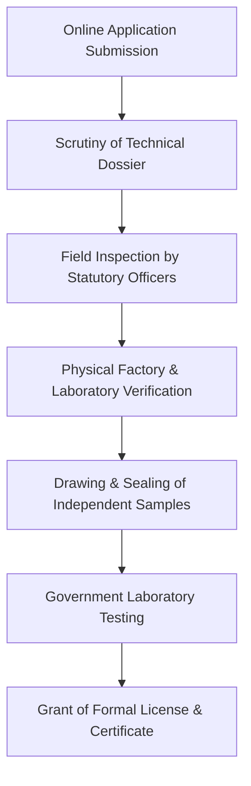

# STATUTORY REGULATORY COMPLIANCE MANUAL: Directorate of Factories & Boilers Industrial Safety License
**Document Code:** LIC_08  
**Facility Tracking:** Karavadi Pure Waters Pvt. Ltd. (KPW)  
**Regulatory Authority:** Factories Inspectorate, Ongole Division  
**Governing Statute:** Government of India / Government of Andhra Pradesh Statutory Framework  

---

## 1. PURPOSE & LEGAL MANDATE

Validates structural plant stability, electrical safety, machinery guarding, fire exits, and worker ventilation.

- **Applicant Entity:** Karavadi Pure Waters Pvt. Ltd.
- **Factory Address:** Sy No. 142/2A, Karavadi Village, Ongole Mandal, Prakasam Dt, Andhra Pradesh - 523182
- **Jurisdictional Office:** Factories Inspectorate, Ongole Division
- **Statutory Validity:** As per authority schedule (Renewable on periodic audit)

---

## 2. STATUTORY DOCUMENTATION DOSSIER CHECKLIST

| S.No | Required Statutory Enclosure | Issuing Authority / Document Scope | Verification Status |
| :--- | :--- | :--- | :--- |
| **01** | Certificate of Company Incorporation / Udyam MSME | Ministry of Corporate Affairs / MSME | Verified Attached |
| **02** | Registered Land Sale Deed / 15-Year Industrial Lease | Sub-Registrar Office, Ongole | Verified Attached |
| **03** | Gram Panchayat Commercial Conversion & Building Plan | Karavadi Gram Panchayat | Verified Attached |
| **04** | Hydrogeological Water Yield & Aquifer Pumping Report | Approved Hydrogeologist / CGWB | Verified Attached |
| **05** | Factory Layout Drawing showing Sanitary Cleanroom | Chartered Civil Engineer | Verified Attached |
| **06** | Complete Machinery P&ID Process Flow Diagram | Water Treatment Plant OEM | Verified Attached |
| **07** | In-House Lab Testing Equipment List (42 Instruments) | Central QC Laboratory Head | Verified Attached |
| **08** | Appointment Letter & Degree Certificates of Chemist & Micro | B.Sc/M.Sc Technical Personnel | Verified Attached |
| **09** | NABL Laboratory Baseline 52-Parameter Test Report | NABL Accredited Testing Lab | Verified Attached |
| **10** | Statutory Application Fee & Challan Receipt | Online Portal Bharatkosh / Manakonline | Verified Attached |

---

## 3. AUDIT INSPECTION READINESS & COMPLIANCE VERIFICATION

### Key Audit Focus Areas:
1. Complete physical segregation between raw utility zones and Class 100/1000 filling rooms.
2. Calibration validity of all laboratory glass apparatus, spectrophotometers, and incubators.
3. Proper documentation in bound and digitally preserved production and quality logs.
4. Total absence of pathogenic organisms and heavy metals in finished packaged water.
