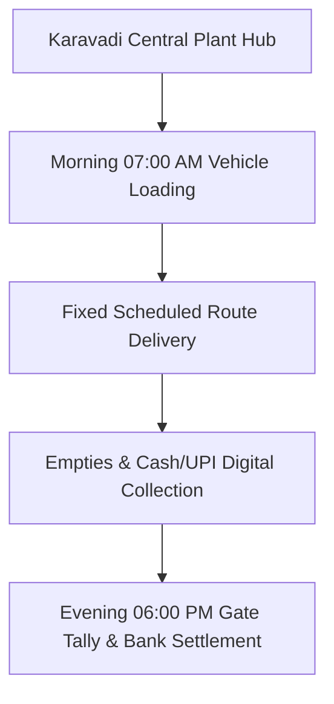

# B2B COMMERCIAL SALES & ROUTE SPECIFICATION: Route Schedule A: Ongole Urban Commercial Core & Institutional Route
**Document Code:** SALES_01_Route_A_Ongole_Urban_Core  
**Facility Tracking:** Karavadi Pure Waters Pvt. Ltd. (KPW)  
**Target Territory:** Ongole, Karavadi, Addanki, Chirala Belt, Prakasam District, AP  

---

## 1. OPERATIONAL SCOPE & TARGET ACCOUNTS

Servicing 65 Kirana shops, 28 offices, 12 hospitals along Collectorate Road, Santhapet, Kurnool Road (24 km loop, Mon/Wed/Fri).

---

## 2. STANDARD ROUTE-TO-MARKET EXECUTION

- **Vehicle Assigned:** 1.5-Ton Tata Ace Gold / Mahindra Bolero Maxi Truck
- **Load Capacity:** 160 units 20L Cans + 50 Cases PET Bottles
- **Average Route Time:** 6.5 Hours per shift
