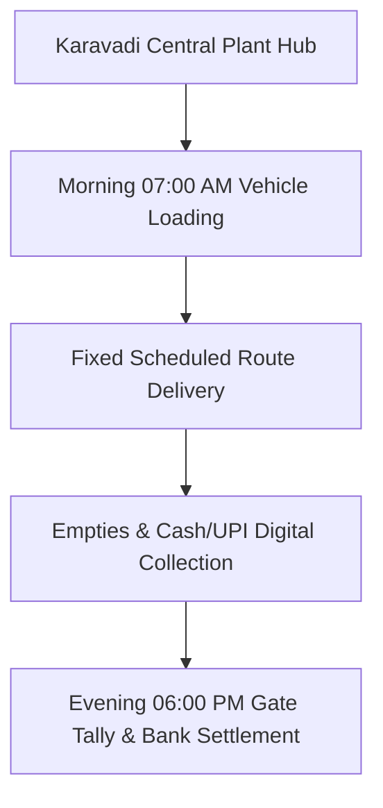

# B2B COMMERCIAL SALES & ROUTE SPECIFICATION: Route Schedule B: NH16 Highway Dhabas & Maddipadu Corridor
**Document Code:** SALES_02_Route_B_NH16_Highway_Corridors  
**Facility Tracking:** Karavadi Pure Waters Pvt. Ltd. (KPW)  
**Target Territory:** Ongole, Karavadi, Addanki, Chirala Belt, Prakasam District, AP  

---

## 1. OPERATIONAL SCOPE & TARGET ACCOUNTS

Servicing 45 Highway Dhabas, 20 Petrol bunks, and rural retail outlets along NH16 north bypass (38 km loop, Tue/Thu/Sat).

---

## 2. STANDARD ROUTE-TO-MARKET EXECUTION

- **Vehicle Assigned:** 1.5-Ton Tata Ace Gold / Mahindra Bolero Maxi Truck
- **Load Capacity:** 160 units 20L Cans + 50 Cases PET Bottles
- **Average Route Time:** 6.5 Hours per shift
