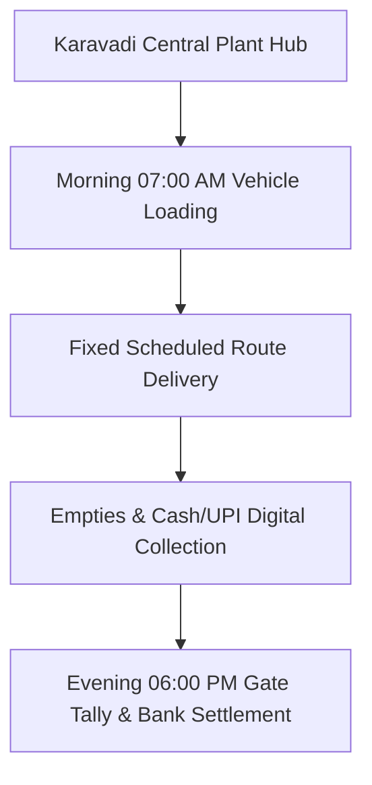

# B2B COMMERCIAL SALES & ROUTE SPECIFICATION: Route Schedule D: Marriage Mandapams, Banquet Halls & Bulk Events
**Document Code:** SALES_04_Route_D_Marriage_Mandapam_Events  
**Facility Tracking:** Karavadi Pure Waters Pvt. Ltd. (KPW)  
**Target Territory:** Ongole, Karavadi, Addanki, Chirala Belt, Prakasam District, AP  

---

## 1. OPERATIONAL SCOPE & TARGET ACCOUNTS

Event-driven weekend delivery dispatch supplying 200–500 cans and 250ml cups to marriage halls across Ongole mandal.

---

## 2. STANDARD ROUTE-TO-MARKET EXECUTION

- **Vehicle Assigned:** 1.5-Ton Tata Ace Gold / Mahindra Bolero Maxi Truck
- **Load Capacity:** 160 units 20L Cans + 50 Cases PET Bottles
- **Average Route Time:** 6.5 Hours per shift
