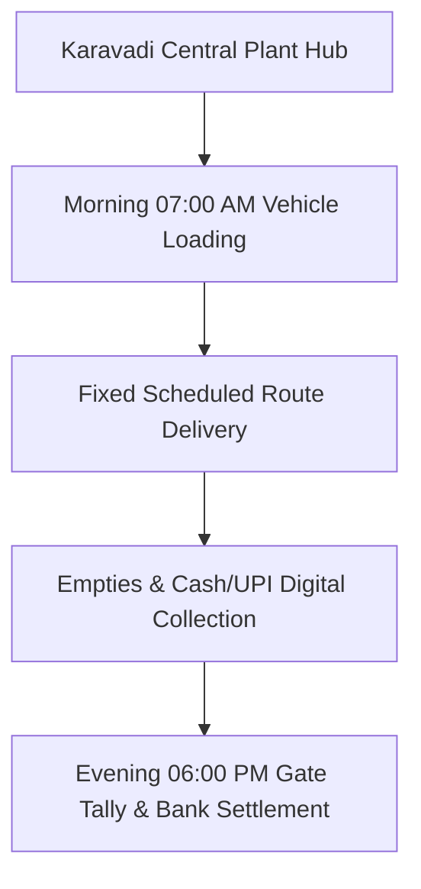

# B2B COMMERCIAL SALES & ROUTE SPECIFICATION: Word-for-Word B2B Sales Pitch Script: Marriage Caterers & Mandapams
**Document Code:** SALES_06_Mandapam_Catering_Contract_Script  
**Facility Tracking:** Karavadi Pure Waters Pvt. Ltd. (KPW)  
**Target Territory:** Ongole, Karavadi, Addanki, Chirala Belt, Prakasam District, AP  

---

## 1. OPERATIONAL SCOPE & TARGET ACCOUNTS

Commercial proposal script for catering contractors featuring ₹2.00/can commission, 100% return policy on unopened stock, and on-time delivery guarantees.

---

## 2. STANDARD ROUTE-TO-MARKET EXECUTION

- **Vehicle Assigned:** 1.5-Ton Tata Ace Gold / Mahindra Bolero Maxi Truck
- **Load Capacity:** 160 units 20L Cans + 50 Cases PET Bottles
- **Average Route Time:** 6.5 Hours per shift
